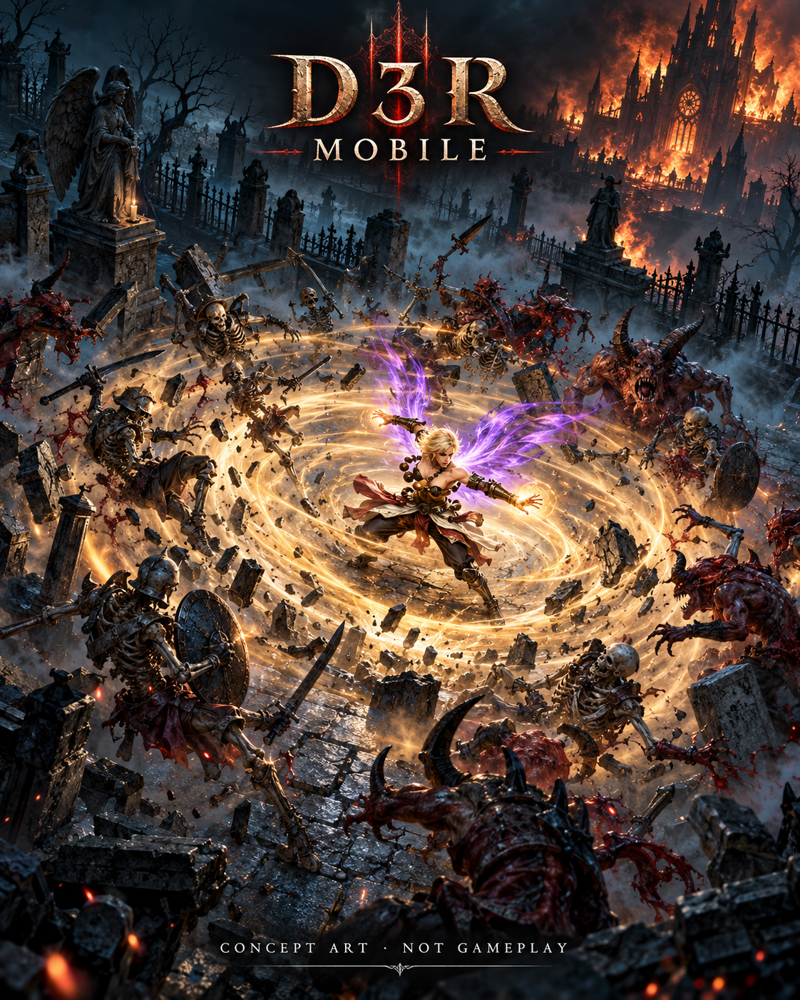
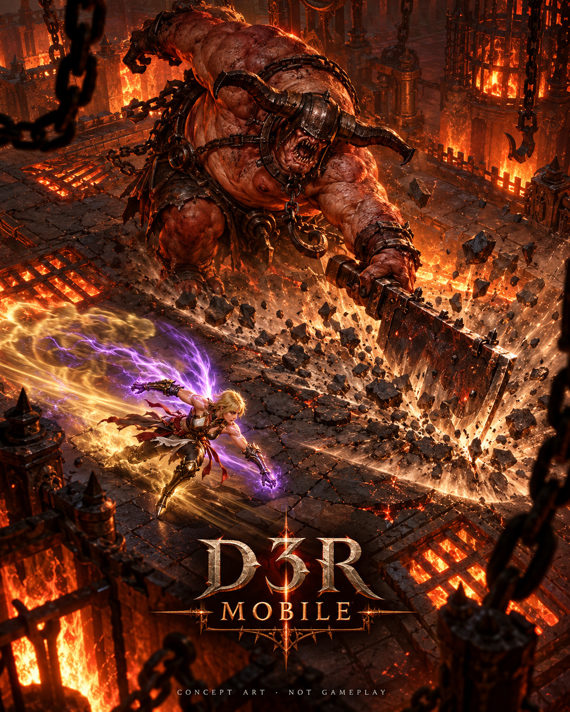
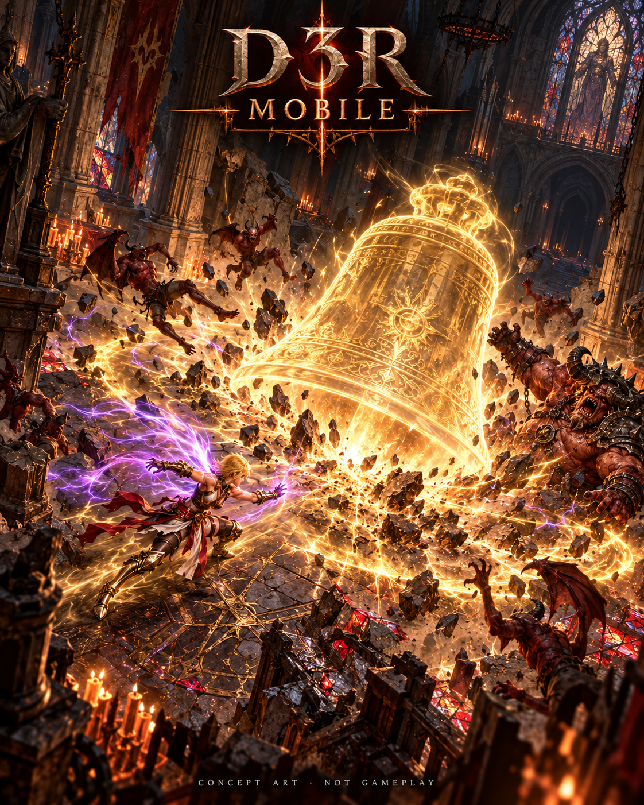

# 战斗概念宣传图

用户提供的战斗概念渲染，非实机截图，不作为游戏兼容性、性能或功能验证证据。
原始图片完整保留，不覆盖 `../x200pro-20261019/` 中的实机素材。

## 01 群怪围攻

- 尺寸：1122×1402，接近 4:5。
- 来源：用户于 2026-10-20 上传。
- 保留图片内的 `CONCEPT ART · NOT GAMEPLAY` 标注，发布时不要裁掉。
- 图片为非官方概念宣传素材，不代表游戏实机画面或官方发行。

## 02 Boss 对决

- 尺寸：1122×1402，接近 4:5。
- 来源：用户于 2026-10-20 上传。
- 保留图片内的 `CONCEPT ART · NOT GAMEPLAY` 标注，发布时不要裁掉。
- 原始图片未修改；同属非官方概念宣传素材，不代表实机战斗验收。

## 03 金钟破爆发

- 尺寸：1122×1402，接近 4:5。
- 来源：用户于 2026-10-20 上传。
- 保留图片内的 `CONCEPT ART · NOT GAMEPLAY` 标注，发布时不要裁掉。
- 原始图片未修改；同属非官方概念宣传素材，不代表实机战斗验收。

## 发布顺序

建议按群怪围攻、Boss 对决、金钟破爆发的顺序发布三张原图。
统一说明这些是战斗概念渲染，不是实机截图或正式发行公告。
