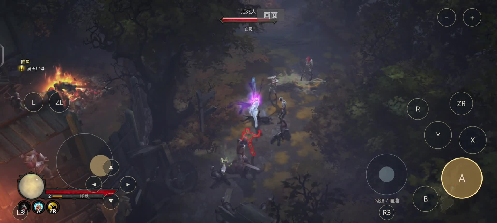

# vivo X200 Pro 第一章触控实机录像

录制日期：2026-10-20（Asia/Shanghai）。由用户在手机上操作，录制过程中不代打。

- 设备：vivo X200 Pro V2405A，天玑 9400，Mali-G925，Android 16。
- 来源：scrcpy 5.0.1 通过 USB ADB 捕获真实屏幕与设备播放音频，没有录麦克风。
- 画面保留虚拟手柄、浮动移动摇杆和实际按键高亮，不是概念渲染。
- 抽查可见第一章城门附近对白、旧崔斯特姆小道移动与战斗；尚未确认录到莉亚对话，不能标为完整“开场至莉亚”流程。

## 本地视频

- [完整录制 MP4](act1-capture-full.mp4)：约 3 分 04 秒，原生 2800×1260，音视频流无重编码；保留系统面板等原始内容。
- [干净发布版 MP4](act1-opening-controls.mp4)：前 2 分 40 秒，1920×864、30fps H.264 与 AAC；截掉末段系统面板，未拼接战斗片段。
- [X 短版 MP4](act1-opening-controls-x.mp4)：发布版开头约 2 分 19 秒，避免超过常见短视频时长限制。

原始 MKV、录制日志和录制前存档备份位于本机 `../../android/build/recording-20261020/`，不上传。
MP4 交付文件保存在此项目目录，按本目录 `.gitignore` 排除，避免大视频误入 Git。
原始截图和概念海报分别保留在其他目录，不混入本次实机录像。

## 处理边界

完整 MP4 仅更换容器。发布版只截取开头、等比缩小和转换视频编码，不裁掉虚拟按钮，不补帧、不加速、不合成战斗、不伪造触摸指示。
发布视频的 30fps 是文件编码规格，不是游戏帧率、稳定性或 AI 插帧验收结论。
本次启动时原生宽屏配置显示需要重启生效；本录像不作为宽屏修复验收。
录屏已停止，未清理游戏数据或重置存档。

