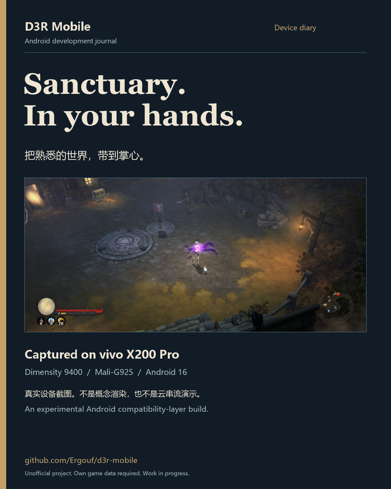
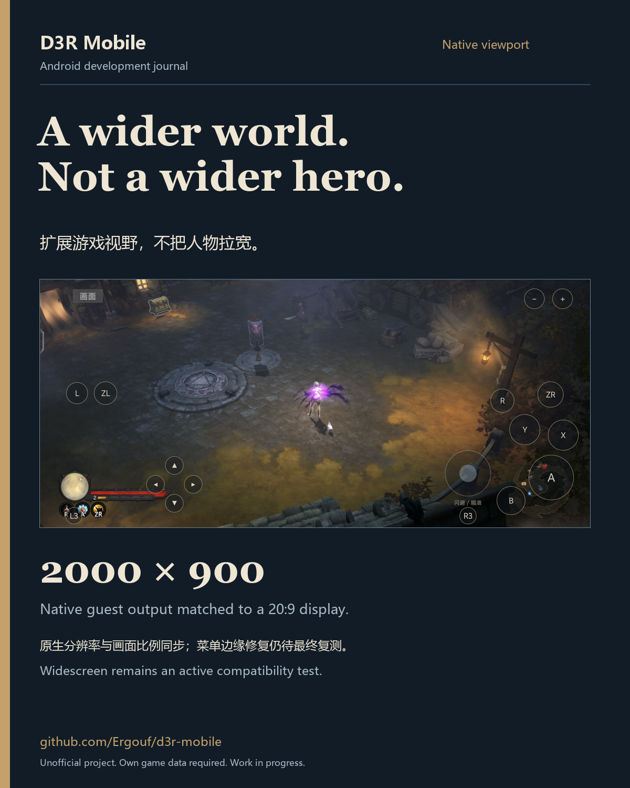
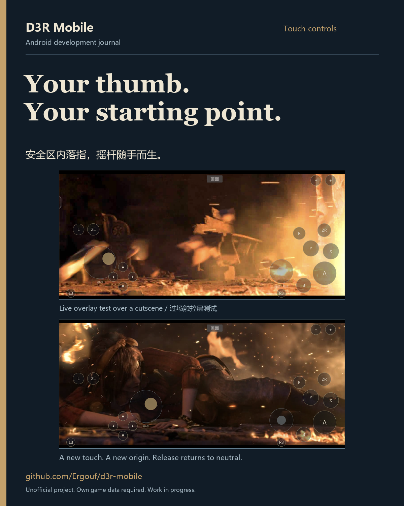
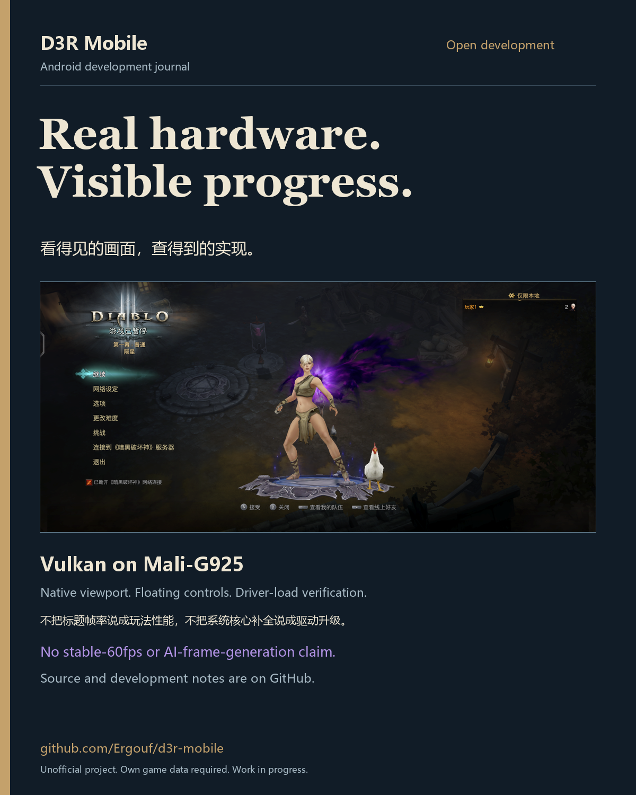

# vivo X200 Pro 实机宣传图

四张 1200×1500、4:5 PNG，适合按顺序作为 X 图集发布。
完整图片、实机原始截图、排版脚本和中英发布文案都在项目内。

- [发布文案与表述边界](CAPTIONS.md)
- [本地 HTML 图集](index.html)
- [原始截图](screens/)、[来源与 SHA-256](sources.json)
- [今日真机记录](../../d3-android/X200PRO_20261019.md)

## 实机运行

## 原生宽屏

## 浮动触控

## 开放开发

项目仍在开发中；不宣称稳定 60fps、AI 插帧成功或全游戏兼容。
主菜单边缘修复候选未完成最终同场景复拍，不能把暂停界面当作该修复验收。
游戏截图只做等比缩放，没有 AI 补画或伪造性能数字。
